# FG Dock

FG Dock เป็น WMS สำหรับงาน FG ส่งออก ระบบรับ Packing Plan จาก vendor (เช่น Mercury) แล้วติดตามของเป็นรายกล่องตาม serial ตั้งแต่รับเข้าคลัง หยิบ จนถึงโหลดขึ้นตู้ container คลังกลางเป็นผู้ดูแลแผนทุกใบ ส่วนคลังสาขาตามโรงงานส่งของเข้ามาหรือโหลดที่โรงงานเองก็ได้

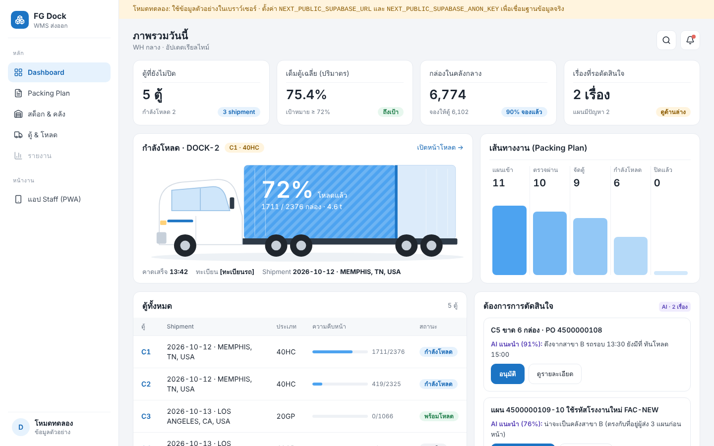

## ระบบมีอะไรบ้าง

| ส่วน | ใช้ทำอะไร | เทคโนโลยี | โฟลเดอร์ |
|---|---|---|---|
| เว็บ | ผู้จัดการและผู้บริหารใช้ดูภาพรวม นำเข้าแผน ดูสต็อก และติดตามการโหลด | Next.js 16, TypeScript, Tailwind v4, three.js | `apps/web` |
| PWA สำหรับพนักงาน | หยิบ โหลดตู้ รับเข้า และวางของ ผ่านมือถือ ติดตั้งจากเบราว์เซอร์ได้ | อยู่ในเว็บที่ `/m` | `apps/web/src/app/m` |
| แอป native | หน้าที่เดียวกับ PWA สำหรับเครื่องสแกน Zebra / Honeywell ที่ใช้ทั้งกะ | Expo (React Native) | `apps/mobile` |
| Backend | ฐานข้อมูล, login, realtime, สิทธิ์ และกติกาการเปลี่ยนสต็อก | Supabase | `supabase/` |
| โค้ดกลาง | อ่าน Packing Plan, คำนวณการจัดเรียงในตู้, ข้อมูลตัวอย่าง | TypeScript | `packages/shared` |

## ลองใช้เลย (ไม่ต้องมีฐานข้อมูล)

ต้องมี Node.js 20.9 ขึ้นไป

```bash
npm install
npm run dev
```

เปิด http://localhost:3000 สำหรับหน้าผู้จัดการ และ http://localhost:3000/m สำหรับหน้าพนักงาน

ถ้ายังไม่ได้ตั้งค่า Supabase ระบบจะเปิดในโหมดทดลอง ข้อมูลตัวอย่างมีตู้ 5 ตู้กับกล่องประมาณ 11,000 กล่อง ตู้ C1 จะโหลดกล่องเองทุก 5 วินาทีเพื่อให้เห็นหน้าจออัปเดตแบบเรียลไทม์ ข้อมูลในโหมดนี้อยู่ในเบราว์เซอร์ รีเฟรชหน้าแล้วจะกลับไปเป็นค่าเริ่มต้น

ลองนำเข้าแผนได้ด้วยไฟล์ [`docs/samples/packing-plan-sample.csv`](docs/samples/packing-plan-sample.csv) (ข้อมูลสมมติ)

## Flow การทำงาน

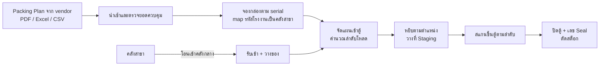

1. Packing Plan มาจาก vendor แผนหนึ่งใบเท่ากับ PO หนึ่งบรรทัด และระบุกล่องเป็นช่วง serial
2. ผู้จัดการนำเข้าไฟล์ ระบบอ่านหัวเอกสารและรายการกล่อง แล้วเทียบผลรวมกับยอดสรุปในเอกสาร
3. เมื่อบันทึก ระบบจองกล่องที่มี serial ตรงกับแผน และแปลงรหัสโรงงานของ vendor (เช่น `HIT HT70`) เป็นคลังสาขาของเรา ถ้านำเข้าแผนเดิมซ้ำจะเก็บเป็น version ใหม่
4. แผนหลายใบที่ส่งวันเดียวกันไปปลายทางเดียวกันถูกรวมเข้าตู้เดียว ระบบคำนวณตำแหน่งของทุกกล่องในตู้และลำดับที่ต้องโหลด
5. ของที่อยู่คลังสาขาถูกโอนเข้าคลังกลาง พนักงานสแกนรับเข้าและวางตามตำแหน่ง
6. พนักงานหยิบกล่องตามตำแหน่งในคลังไปวางที่ Staging ของตู้นั้น
7. ตอนโหลด หน้าจอบอกกล่องถัดไปและตำแหน่งในตู้ ระบบปฏิเสธกล่องที่ไม่ได้อยู่ในแผนของตู้
8. โหลดครบแล้วใส่เลข Seal เพื่อปิดตู้ กล่องทั้งหมดในตู้เปลี่ยนเป็นส่งออกแล้ว

สถานะของกล่องเดินตามลำดับนี้


## วิธีใช้งาน: ผู้จัดการคลัง (เว็บ)

### 1. ดูภาพรวมของวัน

หน้า Dashboard แสดงตู้ที่ยังไม่ปิด เปอร์เซ็นต์เต็มตู้เฉลี่ย จำนวนกล่องในคลังกลาง และเรื่องที่รอให้ตัดสินใจ การ์ดใหญ่ตรงกลางเป็นตู้ที่กำลังโหลด สีน้ำเงินในตู้เพิ่มขึ้นตามจำนวนกล่องที่สแกนแล้ว

ด้านขวามีรายการ "ต้องการการตัดสินใจ" เช่น กล่องขาดหรือรหัสโรงงานที่ยังไม่ได้ map แต่ละเรื่องมีคำแนะนำพร้อมระดับความมั่นใจ กดอนุมัติได้จากหน้านี้

### 2. นำเข้า Packing Plan

ไปที่ Packing Plan แล้วกด "นำเข้าไฟล์" ลากไฟล์มาวางหรือคลิกเพื่อเลือก ระบบรับไฟล์ 3 แบบ

- PDF รายงาน Packing Plan ของ vendor ระบบอ่านทั้งหัวเอกสาร ยอดสรุป และรายการกล่อง
- Excel (.xlsx) และ CSV ที่ export จาก vendor portal ระบบจับคู่ชื่อคอลัมน์ให้เอง เช่น `Serial From`, `PO #`, `Pack Code`, `Gross`

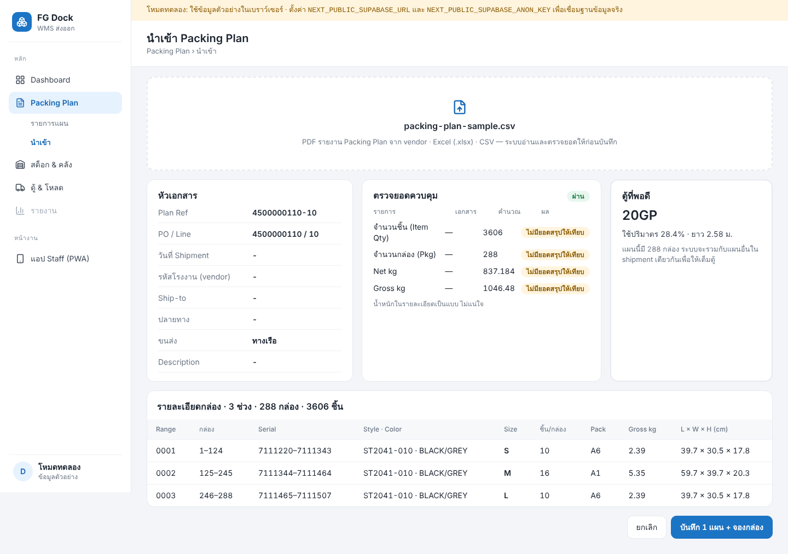

ก่อนบันทึก ให้ดู 3 ส่วนนี้

- หัวเอกสาร: วันที่ shipment, รหัสโรงงาน, ปลายทาง และวิธีขนส่ง (`VL` คือทางเรือ)
- ตรวจยอดควบคุม: จำนวนชิ้น กล่อง และน้ำหนักต้องตรงกับยอดสรุปในเอกสาร ปริมาตรที่คำนวณจากขนาดกล่องต่างได้เล็กน้อยจากการปัดเศษ ระบบจึงแสดงเป็นสีเหลืองถ้าต่างไม่เกิน 3% ไฟล์ CSV และ Excel ไม่มียอดสรุป ช่องนี้จึงขึ้นว่าไม่มีให้เทียบ
- ตู้ที่พอดี: ขนาดตู้เล็กที่สุดที่ใส่แผนนี้ได้ ใช้ดูคร่าว ๆ เพราะตอนจัดจริงระบบรวมหลายแผนเข้าตู้เดียว

กด "บันทึก + จองกล่อง" ระบบจะแจ้งว่าพบกล่องในคลังกี่ใบจากที่แผนระบุ และเตือนถ้ายังต้อง map รหัสโรงงาน

### 3. ตรวจแผน

หน้ารายการแผนมีแถบสัดส่วนสถานะด้านบน และแท็บกรองแผนที่รอตรวจ จัดตู้แล้ว หรือมีปัญหา คลิกเลข Plan Ref เพื่อดูรายละเอียด

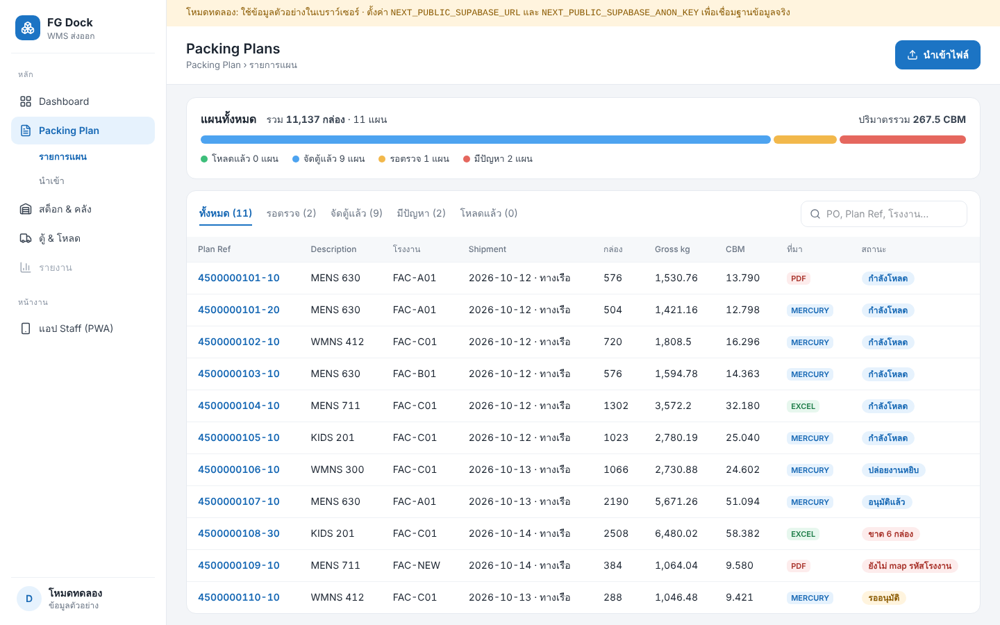

หน้ารายละเอียดแสดงจำนวนกล่องตามสถานะ กล่องที่ยังหาไม่เจอในคลัง ช่วง serial ทั้งหมด และลิงก์ไปหน้าโหลดของตู้ที่แผนนี้อยู่

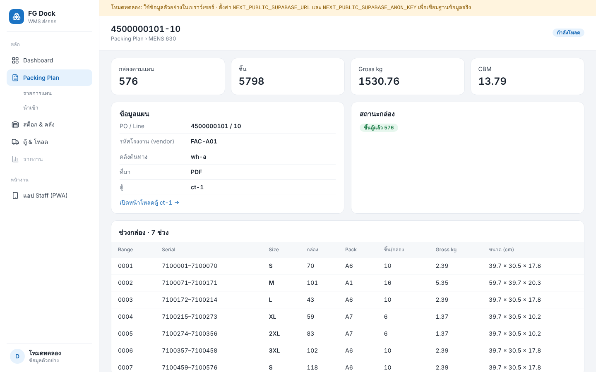

### 4. ดูสต็อก

หน้าสต็อก & คลังมีตัวเลือกคลัง (คลังกลางหรือคลังสาขา) และช่องค้นหาด้วย serial, PO หรือ style ช่องที่ตรงกับคำค้นจะมีขอบสีส้ม

ผัง 2D แสดงทุกช่องในแร็ค ตัวเลขคือจำนวนกล่อง สีบอกว่าในช่องมีกล่องที่จองให้ตู้แล้ว กล่องพร้อมใช้ หรือกล่องที่ถูก Hold คลิกช่องเพื่อดูรายการกล่องด้านซ้าย

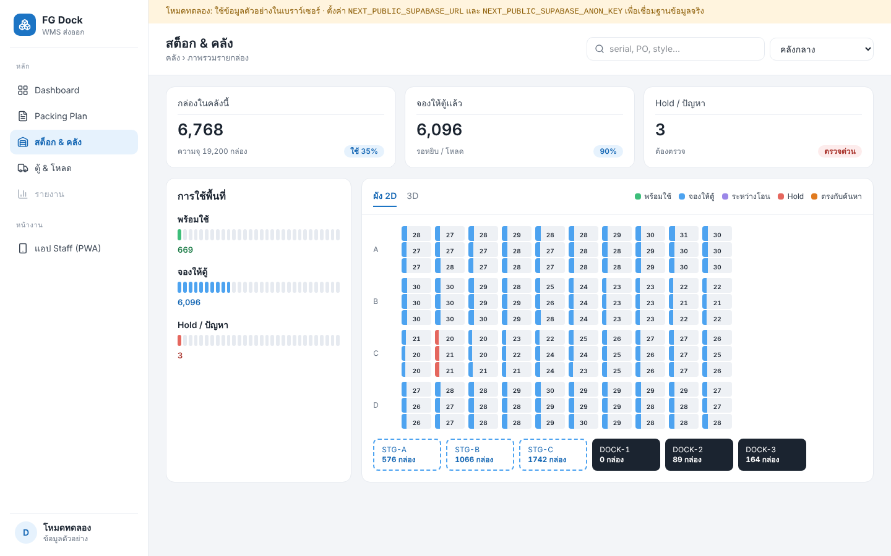

แท็บ 3D แสดงแร็คแบบสามมิติ ลากเพื่อหมุน เลื่อนล้อเมาส์เพื่อซูม และคลิกกล่องเพื่อเลือกช่อง

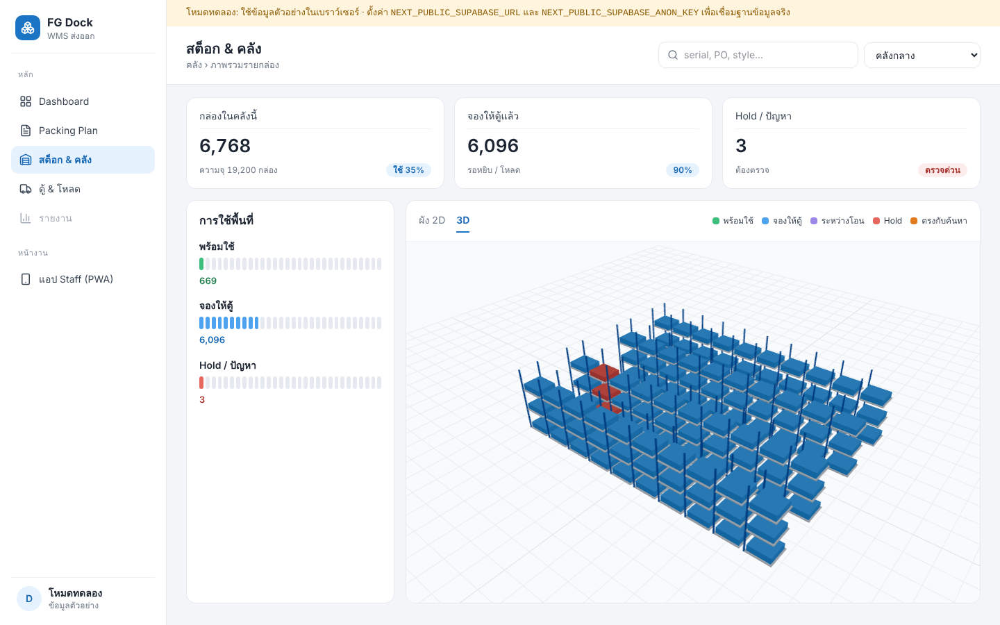

### 5. ติดตามการโหลดตู้

ไปที่ ตู้ & โหลด แล้วเลือกตู้ หน้านี้อัปเดตเองเมื่อพนักงานสแกน

- ภาพด้านข้างแสดงรถกับตู้ พร้อมจำนวนกล่องและน้ำหนักที่โหลดแล้ว
- แถบใต้ภาพแยกความคืบหน้าตาม PO
- การ์ด "กล่องถัดไป" บอก serial และตำแหน่งที่ต้องวางในตู้
- ตารางด้านล่างเรียงกล่องตามลำดับโหลด จัดกลุ่มตาม PO

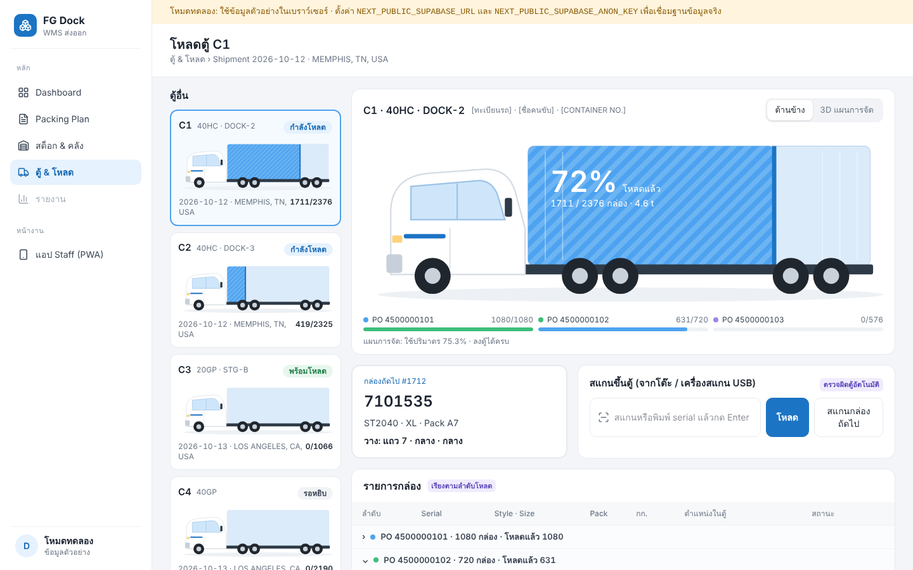

แท็บ "3D แผนการจัด" แสดงตำแหน่งของทุกกล่องในตู้ กล่องที่โหลดแล้วเป็นสีตาม PO กล่องถัดไปเป็นสีน้ำเงินเข้ม ที่เหลือเป็นเงาจาง

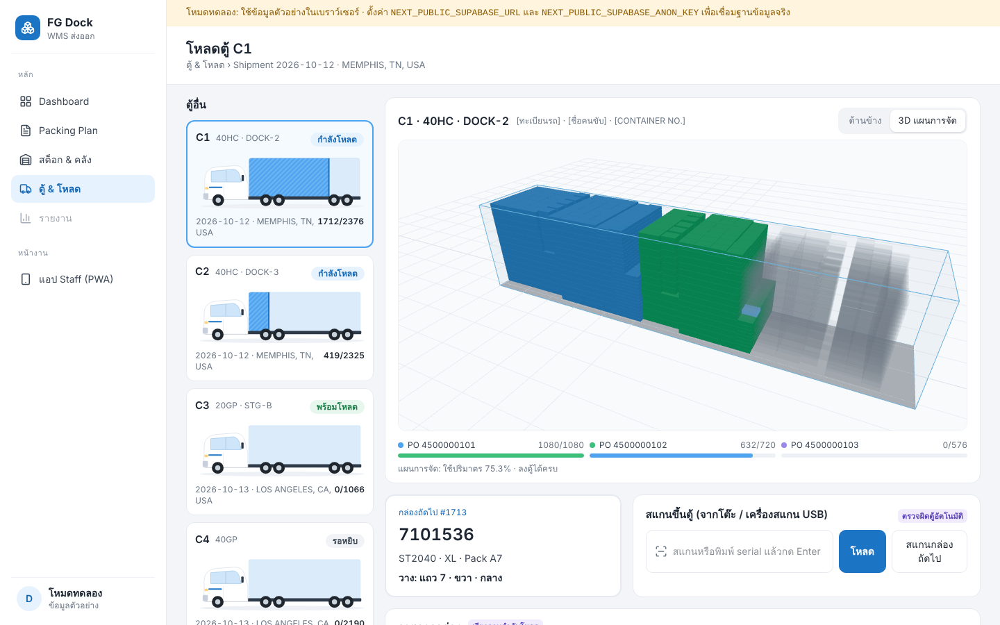

ผู้จัดการสแกนขึ้นตู้จากหน้านี้ได้ด้วยเครื่องสแกน USB หรือพิมพ์ serial เมื่อโหลดครบ ใส่เลข Seal แล้วกด "ปิดตู้ + Seal" ระบบไม่ยอมปิดถ้ายังมีกล่องที่ไม่ได้ขึ้นตู้

## วิธีใช้งาน: พนักงานคลัง (มือถือ / เครื่องสแกน)

### ติดตั้ง

PWA: เปิด `https://<โดเมนของระบบ>/m` บนมือถือ แล้วเลือก "เพิ่มลงหน้าจอหลัก" (Android Chrome) หรือ "Add to Home Screen" (iPhone Safari) การติดตั้งต้องใช้ HTTPS

แอป native: ติดตั้งไฟล์ APK ที่ build จาก EAS ดูขั้นตอนใน [`apps/mobile/README.md`](apps/mobile/README.md)

### หน้างานของฉัน

หน้าแรกมีปุ่มใหญ่ 4 ปุ่ม คือ หยิบ, โหลดตู้, รับเข้า และวางของ ด้านล่างเป็นรายการตู้ที่ยังไม่ปิด มุมขวาบนบอกว่าเครื่องออนไลน์อยู่หรือไม่ และมีกี่รายการที่รอส่ง

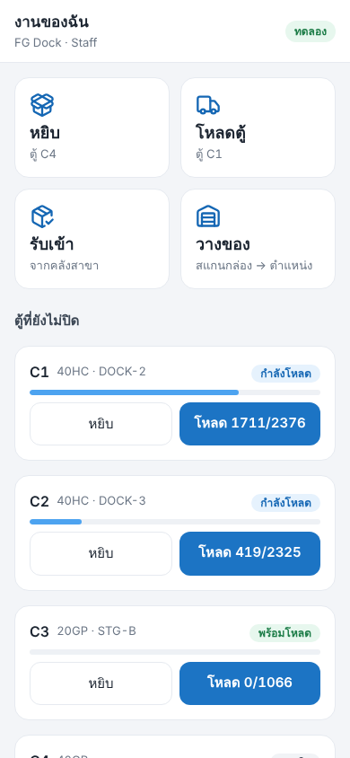

### หยิบ

1. เลือกตู้ หน้าจอบอกตำแหน่งที่ต้องไปด้วยตัวอักษรใหญ่
2. สแกนกล่องทีละใบ กล่องที่สแกนแล้วถูกติ๊กในรายการ
3. ครบตำแหน่งหนึ่งแล้ว หน้าจอเปลี่ยนไปตำแหน่งถัดไปเอง
4. นำกล่องไปวางที่ Staging ของตู้นั้น

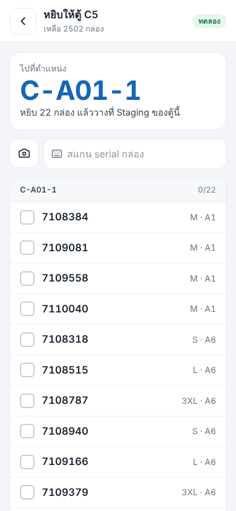

### โหลดตู้

1. เลือกตู้ที่ dock หน้าจอแสดงกล่องถัดไปและตำแหน่งที่ต้องวาง เช่น "แถว 7 · ขวา · กลาง"
2. สแกนกล่อง ถ้าถูกจะมีแถบสีเขียว เสียงบี๊ปสั้น และเครื่องสั่น ถ้าผิดตู้หรือไม่พบ serial จะเป็นแถบสีแดง
3. สแกนกล่องนอกลำดับได้ แต่ระบบจะเตือน
4. เมื่อโหลดครบ ใส่เลข Seal แล้วกดปิดตู้

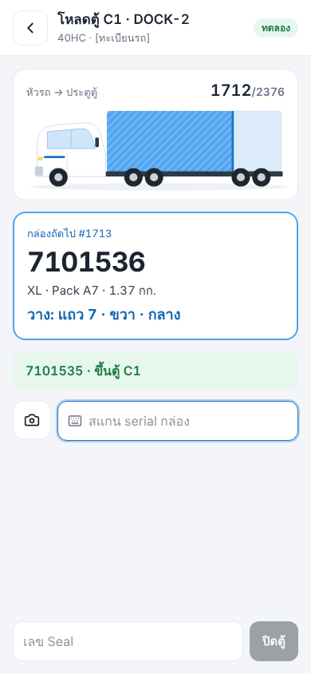

### รับเข้าและวางของ

สแกนป้ายตำแหน่งก่อน (เช่น `C-A04-2`, `STG-A`) แล้วสแกนกล่องต่อกันได้เลย ตำแหน่งจะค้างไว้จนกว่าจะสแกนป้ายใหม่ หน้ารับเข้าไม่บังคับตำแหน่ง ส่วนหน้าวางของต้องสแกนตำแหน่งก่อนทุกครั้ง

### วิธีสแกน

- เครื่องสแกนที่ตั้งเป็น keyboard-wedge และส่ง Enter ต่อท้าย ยิงได้ทันทีโดยไม่ต้องแตะหน้าจอ
- ปุ่มกล้องใช้สแกน Code 128, Code 39, EAN-13 และ QR
- ช่องพิมพ์ใช้เมื่อบาร์โค้ดอ่านไม่ได้

### เมื่อสัญญาณหลุด

สแกนต่อได้ตามปกติ ทุกการสแกนถูกบันทึกในเครื่องก่อนส่ง และส่งให้เองเมื่อกลับมาออนไลน์ ตัวเลข "รอส่ง N" มุมขวาบนบอกว่ายังค้างกี่รายการ การส่งซ้ำไม่ทำให้นับกล่องเกิน เพราะทุกการสแกนมีรหัสเฉพาะของตัวเอง การปิดตู้ต้องรอให้ส่งรายการที่ค้างครบก่อน

## ต่อกับ Supabase จริง

1. สร้าง project ที่ supabase.com หรือรันในเครื่องด้วย `supabase start` (ต้องมี Docker)
2. สร้างตารางและฟังก์ชัน แล้วใส่ข้อมูลตัวอย่างถ้าต้องการ

   ```bash
   supabase db push
   psql "$DATABASE_URL" -f supabase/seed.sql
   ```

3. ใส่ค่าเชื่อมต่อใน `apps/web/.env.local` และ `apps/mobile/.env`

   ```
   NEXT_PUBLIC_SUPABASE_URL=...
   NEXT_PUBLIC_SUPABASE_ANON_KEY=...
   ```

   แอป native ใช้ชื่อ `EXPO_PUBLIC_SUPABASE_URL` และ `EXPO_PUBLIC_SUPABASE_ANON_KEY`

4. สร้างผู้ใช้ใน Supabase Auth ผู้ใช้ใหม่ได้สิทธิ์ `staff` ถ้าต้องการให้เป็นผู้จัดการ ให้รัน

   ```sql
   update profiles set role = 'manager' where id = '<user id>';
   ```

5. เพิ่ม mapping รหัสโรงงานของ vendor ในตาราง `vendor_factory_map` เช่น `MERCURY / HIT HT70 → wh-a`

### สิทธิ์

| บทบาท | ทำได้ |
|---|---|
| `staff` | ดูข้อมูลทั้งหมด สแกนทุกแบบ ปิดตู้ |
| `manager` | ทุกอย่างของ staff, นำเข้าแผน, จัดแผนเข้าตู้, ตัดสินใจเรื่องที่ AI เสนอ, แก้ข้อมูลหลัก |
| `director` | สิทธิ์เท่า manager |

สต็อกเปลี่ยนได้ทางเดียวคือฟังก์ชัน `scan_carton` ทุกครั้งที่เรียกจะมีบันทึกใน `stock_txns` ใช้ตรวจย้อนหลังได้ว่าใครสแกนกล่องไหนจากเครื่องไหน

## สำหรับนักพัฒนา

```
apps/web          Next.js: หน้าผู้จัดการ + PWA ที่ /m
apps/mobile       Expo: แอปเครื่องสแกน (ไม่ใช่ npm workspace ติดตั้งในโฟลเดอร์นี้)
packages/shared   types, อ่าน Packing Plan, คำนวณตู้, ข้อมูลตัวอย่าง
supabase          migrations, seed.sql
scripts           gen-seed.ts, sql-test.mjs, screenshots.mjs
docs              flow ธุรกิจ, รูปแบบ Packing Plan, ดีไซน์, ภาพหน้าจอ
```

| คำสั่ง | ใช้ทำอะไร |
|---|---|
| `npm test` | unit test ของโค้ดกลาง |
| `npm run typecheck` | ตรวจ type ของ shared และ web |
| `npm run build` | build เว็บสำหรับ production |
| `npx tsx scripts/gen-seed.ts` | สร้าง `supabase/seed.sql` ใหม่จากข้อมูลตัวอย่าง |
| `node scripts/sql-test.mjs <dir>` | รัน migration, seed และทดสอบฟังก์ชันบน Postgres จริง (`<dir>` คือโฟลเดอร์ที่ติดตั้ง `embedded-postgres` และ `pg`) |
| `node scripts/screenshots.mjs <url> <playwright> <chrome>` | ถ่ายภาพหน้าจอชุดนี้ใหม่ |

หน้าจอทุกหน้าคุยกับข้อมูลผ่าน interface `WmsApi` ใน `apps/web/src/lib/api` ซึ่งมี 2 แบบ คือ Supabase และ Demo ถ้าแก้กติกาในฟังก์ชัน SQL ต้องแก้ Demo ทั้งฝั่งเว็บและ `apps/mobile/src/lib/demoApi.ts` ให้ตรงกัน

ข้อจำกัดตอนนี้

- การจัดเรียงในตู้ใช้วิธีเรียงเป็นแนวตั้งทีละแถว ได้ประมาณ 75% ของปริมาตรตู้เมื่อกล่องหลายขนาดปนกัน
- ยังไม่มีหน้าจอจัดแผนเข้าตู้ด้วยมือ ใบโอนจากคลังสาขา ตั้งค่า map รหัสโรงงาน และรายงาน ส่วนฟังก์ชันฝั่งฐานข้อมูลสำหรับจัดแผนเข้าตู้มีแล้ว (`assign_plan_to_container`)

## เอกสารเพิ่มเติม

- [`docs/01-business-flow.md`](docs/01-business-flow.md) flow ธุรกิจและ 3 แบบของแหล่งของ
- [`docs/06-packing-plan-format.md`](docs/06-packing-plan-format.md) ความหมายของทุกคอลัมน์ใน Packing Plan
- [`docs/08-ux-v3-clean-saas.md`](docs/08-ux-v3-clean-saas.md) ดีไซน์และสีที่ใช้
- [`apps/mobile/README.md`](apps/mobile/README.md) แอปเครื่องสแกน, build APK และตั้งค่า DataWedge / Honeywell
