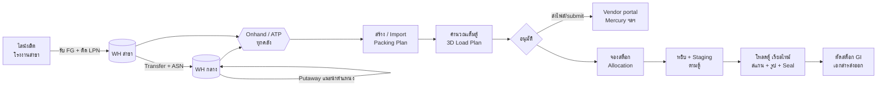
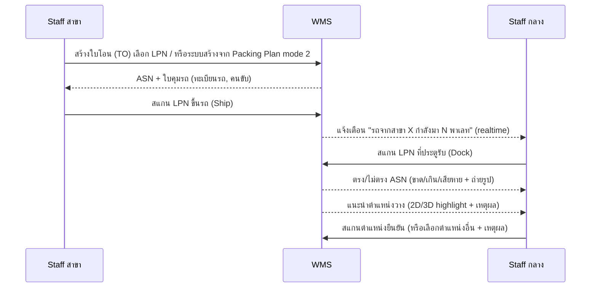
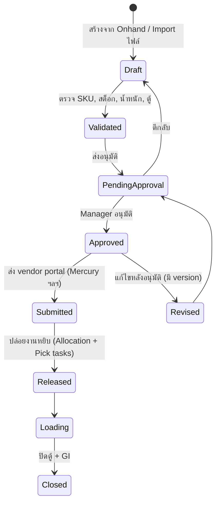

# 01 — Business Flow: WMS FG ส่งออก (Export FG)

> ขอบเขต: งาน FG (Finished Goods) ตั้งแต่รับเข้าคลัง → เก็บ → วาง Packing Plan → หยิบ → โหลดเข้าตู้ container → ปิดตู้/ส่งออก
> เจ้าของกระบวนการ: **Warehouse กลาง (WH-C)** เป็นผู้แจ้ง Packing Plan และควบคุมการโหลดทุกกรณี แม้ของจะมาจาก Warehouse สาขา (WH-B) ก็ตาม

## 1. ตัวละคร (Actors)

| Actor | ใช้อุปกรณ์ | งานหลัก |
|---|---|---|
| Staff WH สาขา (WH-B) | Handheld / มือถือ (React Native) | รับ FG จากไลน์ผลิต, ติด LPN, ส่งโอนเข้า WH-C, หยิบ/โหลดกรณี mode 3 |
| Staff WH กลาง (WH-C) | Handheld / แท็บเล็ต | รับของจากสาขา, วางของตามคำแนะนำ, หยิบ, จัด staging, โหลดตู้, ถ่ายรูป, ใส่ seal |
| Manager WH (กลาง) | Web (desktop) | ดู onhand, สร้าง/import Packing Plan, คำนวณตู้, อนุมัติ, ปล่อยงานหยิบ, ติดตามเรียลไทม์ |
| Director | Web / มือถือ | Dashboard ภาพรวม: ตู้วันนี้, % เต็มตู้, ส่งตรงเวลา, ปัญหา |
| Vendor portal (Mercury ฯลฯ) | — | ปลายทางที่ต้อง submit Packing Plan |

## 2. ภาพรวม End-to-End

## 3. Flow A — รับ FG จากไลน์ผลิตที่สาขา (รายวัน)

1. ไลน์ผลิตส่ง FG เป็นพาเลท → Staff สาขาสแกน/เลือก SKU, Lot, วันที่ผลิต, จำนวนกล่อง
2. ระบบออก **LPN (License Plate Number)** = QR ติดพาเลท 1 ใบต่อพาเลท
3. ระบบแนะนำตำแหน่งเก็บในคลังสาขา (หรือวางที่ "รอโอน" ถ้ามีแผนโอนเข้ากลางแล้ว)
4. สแกนตำแหน่งเพื่อยืนยัน → stock เข้า WH-B

## 4. Flow B — โอนจากสาขา → WH กลาง + รับเข้า + แนะนำวางของ

### กติกาแนะนำวางของ (Putaway scoring)
คะแนนรวมจากหลายเงื่อนไข เลือกตำแหน่งคะแนนสูงสุด แสดง 3 อันดับให้เลือก:

| เงื่อนไข | เหตุผล |
|---|---|
| มีใน Packing Plan ที่ ETD ≤ 3 วัน → ใกล้ dock/staging | ลดระยะหยิบตอนโหลด |
| SKU / ลูกค้า / ปลายทางเดียวกันอยู่ใกล้กัน | หยิบรวบได้, นับง่าย |
| พาเลทหนัก → ชั้นล่าง | ความปลอดภัย |
| ขนาดพอดีช่อง (W×D×H, น้ำหนักรับได้) | ไม่เสียพื้นที่ |
| FIFO: ไม่วางของใหม่บังของเก่า (floor stack/drive-in) | หยิบของเก่าก่อนได้ |
| ความเร็วการเคลื่อนไหว (ABC) | A ใกล้ทางเดินหลัก |

## 5. Flow C — ดู Onhand (2D / 3D)

- **ตาราง**: SKU, ลูกค้า, Lot, วันผลิต, คลัง, ตำแหน่ง, จำนวน (กล่อง/ชิ้น/พาเลท), สถานะ (ว่าง / จองแล้ว / Hold / QC)
- **2D**: ผังคลังมองจากด้านบน ช่องสีตาม % เต็ม หรือตามสถานะ คลิกช่องเห็นพาเลทข้างใน
- **3D**: rack แบบ isometric หมุนได้ ไฮไลต์ SKU ที่ค้นหา / ของที่จองให้ Packing Plan
- **ATP (Available-to-Promise)** = Onhand − จองแล้ว − Hold → ใช้สร้าง Packing Plan

## 6. Flow D — Packing Plan (สร้าง / Import / อนุมัติ)

**แหล่งของ (Source mode)** — เลือกที่ระดับแผน และปรับรายบรรทัดได้:

| Mode | ของมาจาก | จุดโหลด | งานที่ระบบสร้างให้ |
|---|---|---|---|
| 1. กลาง 100% | WH-C | WH-C | Pick tasks ที่ WH-C |
| 2. ผสม 50/50 (หรือ % ใดก็ได้) | WH-C + WH-B | WH-C (default) หรือ multi-stop | Pick ที่ WH-C + Transfer Order จาก WH-B ให้มาถึงก่อนวันโหลด (cross-dock เข้า staging ตรง) |
| 3. สาขา 100% | WH-B | WH-B (รถตู้ไปรับที่โรงงาน) | Pick + Load tasks ที่ WH-B แต่ WH-C ยังเป็นผู้ดูแล/อนุมัติ/ดูเรียลไทม์ |

**Import**: รองรับ Excel/CSV ตาม template ของแต่ละ vendor (mapping column ตั้งค่าได้ต่อ vendor) → แสดง preview + error รายบรรทัดก่อนบันทึก

**Allocation (จองสต็อก)**: FIFO ตามวันผลิต → พาเลทเต็มก่อนเศษ → ตำแหน่งน้อยที่สุด → ตาม source mode

## 7. Flow E — คำนวณเต็มตู้ (Container Fit)

Input: บรรทัดที่เลือก (SKU × กล่อง/พาเลท), ขนาด/น้ำหนักกล่องและพาเลท, ประเภทตู้ (20GP / 40GP / 40HC / 45HC)

Output:
- % ปริมาตร, % น้ำหนัก (เทียบ max payload), จำนวนพาเลท/กล่องที่ลงได้, ของที่ล้น
- คำแนะนำ: "เพิ่ม SKU X อีก 12 กล่องจะเต็ม 98%" หรือ "ใช้ 40HC แทน 2×20GP"
- **3D Load Plan**: ตำแหน่งแต่ละพาเลท/กล่อง + ลำดับโหลด (Load sequence: ในสุดก่อน)

กติกา: ของหนักล่าง, ห้ามซ้อนเกินที่กำหนด, ของ PO/ปลายทางเดียวกันอยู่ด้วยกัน, ของที่ต้องตรวจ (sampling) อยู่ใกล้ประตู

## 8. Flow F — หยิบ (Picking) แนะนำ 2D/3D

1. Release แผน → ระบบสร้าง Pick tasks ต่อ **ตู้** เรียงตาม Load sequence ย้อนกลับ (ของที่โหลดก่อนต้องอยู่ staging พร้อมก่อน)
2. Staff เห็น "งานต่อไป" ทีละงาน: ตำแหน่ง (ตัวใหญ่), SKU, จำนวน, รูปพาเลท, แผนที่ 2D เส้นทางเดิน, (แท็บเล็ต: 3D ไฮไลต์ช่อง)
3. สแกนตำแหน่ง → สแกน LPN → (หยิบไม่ครบพาเลท: ใส่จำนวน + ออก LPN ใหม่) → วางที่ Staging lane ของตู้นั้น → สแกน lane
4. ผิด SKU/Lot → ระบบเตือนทันที, หาของแทนได้ (suggest alternative LPN)

## 9. Flow G — โหลดตู้เรียลไทม์

1. ตู้มาถึง: บันทึกเลขตู้, ทะเบียนรถ, ถ่ายรูปตู้เปล่า (5 ด้าน), ตรวจสภาพ
2. โหลดตาม 3D plan: สแกน LPN ทีละพาเลท → 3D ระบายสีช่องที่โหลดแล้ว
3. ถ่ายรูปครึ่งตู้ / เต็มตู้ / ปิดประตู + เลข Seal
4. ปิดตู้ → ตัดสต็อก (GI) → ออก Packing List / Loading Report (PDF) → อัปเดตสถานะใน vendor portal
5. Manager/Director เห็น progress ทุกตู้แบบเรียลไทม์ (SignalR)

## 10. ข้อยกเว้นที่ต้องรองรับ (Exceptions)

- ของไม่พอตอนหยิบ (onhand ไม่ตรง) → แจ้ง Manager, เลือก: หาของแทน / ลดจำนวน / ย้ายไปตู้ถัดไป (roll-over)
- ตู้ล้น/ไม่เต็มตอนโหลดจริง → ปรับ plan หน้างาน (ต้องมีสิทธิ์ + เหตุผล)
- รถจากสาขามาไม่ทัน (mode 2) → แจ้งเตือนล่วงหน้าเมื่อ Transfer ยังไม่ Ship ภายในเวลาที่ตั้ง
- Packing Plan ถูกแก้ใน vendor portal หลัง submit → version ใหม่ + diff
- ของเสียหายตอนรับ/โหลด → Hold + รูป + เหตุผล
