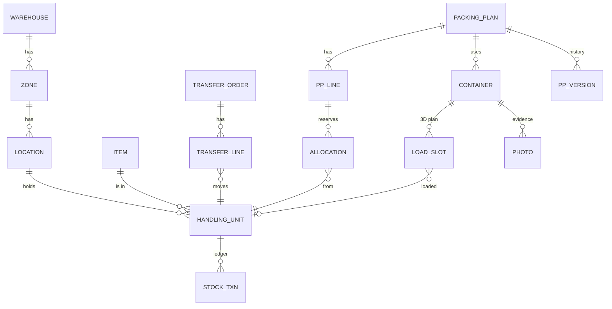

# 03 — Architecture & Data Model (จาก Senior Dev)

## Stack

| ส่วน | เลือก | เหตุผล |
|---|---|---|
| Web (Manager/Director) | React + TypeScript (Vite), TanStack Query, Tailwind | stack เดิมของทีม |
| 3D | three.js ผ่าน `@react-three/fiber` + `@react-three/drei` | rack/ตู้เป็นกล่อง ใช้ instanced mesh เร็วพอแม้หลายพันพาเลท |
| 2D map | SVG (เขียนเอง) | ผังคลังเป็นกริด, คลิก/zoom ง่าย, ใช้ได้ทั้ง web และ RN (`react-native-svg`) |
| Mobile (Staff) | React Native (Expo), Vision Camera สแกน QR + รองรับ hardware scanner (Zebra/Honeywell ผ่าน keyboard wedge/Intent) | ชื่อ repo `wms-native` |
| API | .NET 8 Web API, EF Core | stack เดิม |
| Realtime | SignalR (group ต่อ warehouse / ต่อตู้) | เรียลไทม์ตอนโหลด, รถสาขากำลังมา |
| DB | MSSQL | stack เดิม; stock ledger แบบ append-only |
| Background jobs | Hangfire | import ไฟล์, sync vendor, แจ้งเตือน |
| File/Photo | Object storage (MinIO / S3-compatible) | รูปตู้, เอกสาร |
| Container fit | TypeScript package ใช้ร่วม web + API (Node worker) หรือ port เป็น C# | คำนวณสดตอนเลือกของบน web; คำนวณจริงฝั่ง server ก่อนอนุมัติ |

## Monorepo

```
wms-native/
├─ apps/
│  ├─ web/            React TSX — Manager/Director
│  └─ mobile/         React Native (Expo) — Staff
├─ services/
│  └─ api/            .NET 8 Web API + SignalR + Hangfire
├─ packages/
│  ├─ shared/         types, status enums, API client (generated from OpenAPI)
│  ├─ container-fit/  algorithm: pallet floor-slot + carton 3D packing
│  └─ warehouse-viz/  2D (SVG) + 3D (r3f) components ใช้ร่วม
├─ db/                migrations + seed (ผังคลังตัวอย่าง, SKU ตัวอย่าง)
├─ docs/
└─ .claude/agents/    5 role agents
```

## Data Model (หลัก)



| ตาราง | ฟิลด์สำคัญ |
|---|---|
| `Warehouse` | code, name, type (CENTRAL/BRANCH), factoryId |
| `Location` | code (เช่น C-A03-02-1), type (RACK/FLOOR/STAGING/DOCK), x,y,z (เมตร), w,d,h, maxWeight, maxPallets, pickSeq |
| `Item` | sku, customerId, cartonL/W/H/kg, cartonsPerPallet, palletL/W/H, maxStack, fragile |
| `HandlingUnit` | lpn (unique), itemId, lot, prodDate, cartons, status (AVAILABLE/RESERVED/HOLD/IN_TRANSIT/STAGED/LOADED/SHIPPED), locationId, warehouseId, rowVersion |
| `StockTxn` | hu, from/to location, qty, type (RECEIVE/PUTAWAY/MOVE/TRANSFER_OUT/IN/PICK/LOAD/GI/ADJUST), refDoc, userId, deviceId, at |
| `PackingPlan` | ppNo, customer, vendorSystem (MERCURY/…), vendorRef, etd, bookingNo, sourceMode, loadingWarehouseId, status, version |
| `PpLine` | sku, poNo, destination, cartons, sourceWarehouseId (nullable = auto) |
| `Allocation` | ppLineId, huId, cartons, status |
| `Container` | ppId, type, containerNo, sealNo, truckNo, loadingWarehouseId, status, fillVolPct, fillWtPct |
| `LoadSlot` | containerId, seq, x,y,z, rot, huId / cartonGroup, loadedAt |
| `ContainerType` | code, innerL/W/H, doorW/H, maxPayloadKg |
| `VendorTemplate` | vendor, columnMapping (JSON), exportFormat |

> **กฎเหล็ก**: สต็อกเปลี่ยนผ่าน `StockTxn` เท่านั้น, ทุกการสแกนมี `deviceId` + `clientTxnId` (idempotent สำหรับ offline sync), ใช้ `rowVersion` กันจองซ้ำ

## Container Fit — แนวทางอัลกอริทึม

1. **Phase 1 (MVP) — โหลดเป็นพาเลท**: 2D floor bin-packing ของ footprint พาเลท (ลองหมุน 0/90°) × จำนวนชั้นซ้อนที่ได้ (min(maxStack, H ตู้ / H พาเลท)) → ตรวจน้ำหนัก → จัด seq จากในสุด
2. **Phase 2 — โหลดกล่องเปล่า (loose carton)**: 3D heuristic แบบ Extreme-Point / Layer-building (ชั้นละ SKU) รองรับ hybrid (พาเลท + กล่องอุดช่อง)
3. ผลลัพธ์เก็บเป็น `LoadSlot` → ใช้ทั้งโชว์ 3D, สั่งโหลด, และติดตามเรียลไทม์

## API (ตัวอย่าง)

```
GET  /onhand?sku=&warehouse=&status=           → ตาราง + summary
GET  /warehouses/{id}/layout                    → location geometry สำหรับ 2D/3D
POST /receipts/{asn}/scan  {lpn}                → match ASN
GET  /putaway/suggest?lpn=                      → top-3 locations + reasons
POST /packing-plans            /import           → draft
POST /packing-plans/{id}/fit   {containerType}   → fill %, slots, overflow, hints
POST /packing-plans/{id}/approve | /submit | /release
GET  /pick-tasks/next?device=                   → งานถัดไป
POST /containers/{id}/load-scan {lpn}           → broadcast SignalR "container:{id}"
```

## Integration กับ Vendor portal (Mercury ฯลฯ)

ลำดับที่แนะนำ: **(1) Export ไฟล์ตาม format vendor** ให้คน upload เอง → **(2) ถ้า vendor มี API/EDI** ทำ connector → **(3) RPA (browser automation)** เป็นทางสุดท้าย เพราะเปราะเมื่อหน้าเว็บ vendor เปลี่ยน
ทุก vendor เป็น adapter แยก (`IVendorAdapter`: Import, Export, Submit, FetchStatus)
